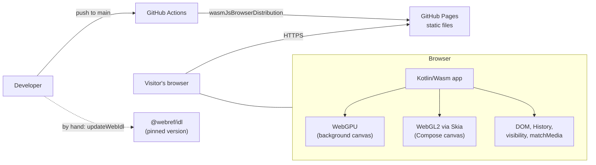
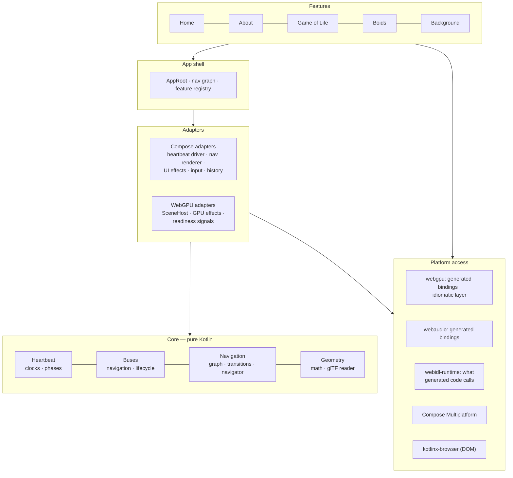
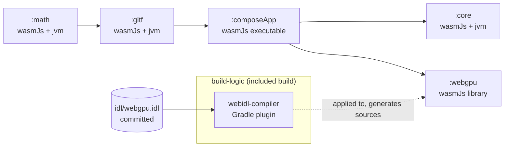
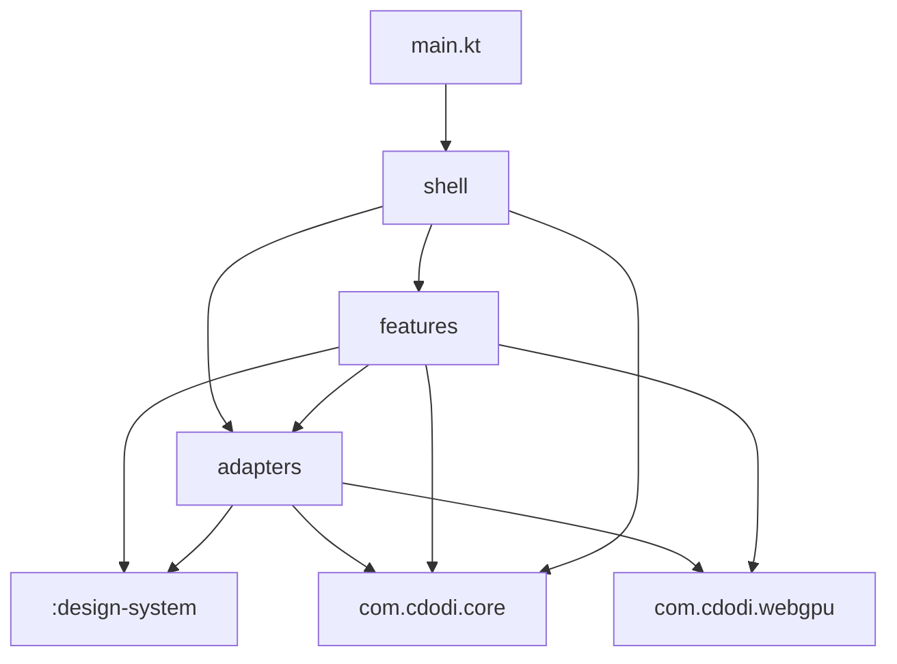
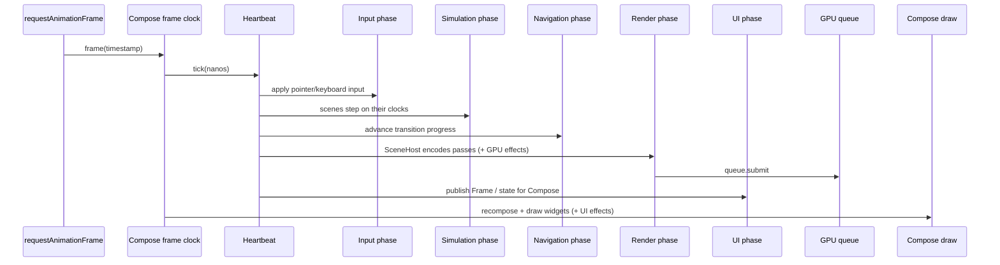
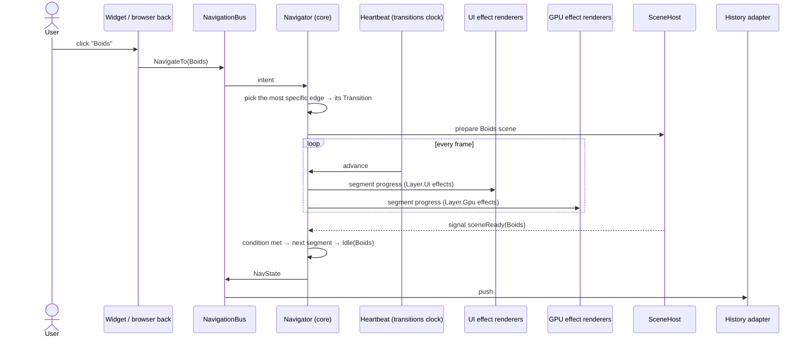
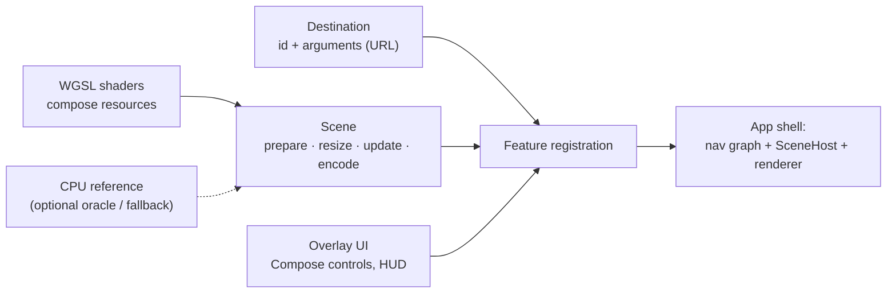
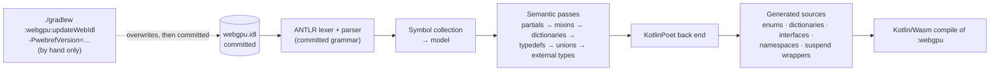

# Architecture

_High-level architecture of the site after the move to WebGPU. This describes the target structure and how the parts fit together; the step-by-step path to get there is in `PLAN.md`._

## 1. Principles

1. **Two layers of rendering.** WebGPU draws everything graphical, on a background canvas. Compose draws the interactive UI, on a transparent canvas on top.
2. **One clock.** The heartbeat is the single source of truth for time. Every animation, simulation and transition takes its time from it.
3. **The core knows no framework.** Time, buses and navigation are pure Kotlin. Compose and WebGPU are plugged in through adapters.
4. **Dependencies point inward.** Features depend on adapters and the core; the core depends on nothing.
5. **Describe, then render.** The core describes *what* should happen (a transition with effects on a layer); the adapters decide *how* it's drawn.
6. **Generated, type-safe platform access.** WebGPU is used through bindings generated by our own WebIDL compiler, from a committed and pinned spec.
7. **Degrade gracefully.** No WebGPU, a lost GPU device or reduced-motion settings all lead to a working site, not a blank page.

## 2. System context



The site is fully static: no backend. The only network step outside the visitor's page load is the manual IDL update, which a developer runs by hand; the normal build doesn't touch the network.

## 3. Layers



| Layer | Owns | May depend on | Must not depend on |
|---|---|---|---|
| **Core** | Time, buses, navigation model; geometry and the glTF reader (`:math`, `:gltf`) | Kotlin stdlib, kotlinx-coroutines, kotlinx-serialization (the glTF JSON) | Compose, WebGPU, DOM |
| **Platform access** | Type-safe WebGPU API, resource ownership | Kotlin/Wasm interop, kotlinx-browser | Core, features |
| **Adapters** | Turning core descriptions into pixels and events | Core, platform access | Features |
| **App shell** | Wiring: graph definition, registries, startup, fallback | Everything below | — |
| **Features** | A page: its destination, scene, UI and shaders | Core, adapters, platform access | Other features |

## 4. Program structure

### 4.1 Repository layout

```
maximums.github.io/
├── build-logic/                    included build: everything that runs at build time
│   ├── settings.gradle.kts
│   ├── conventions/                convention plugins shared by the modules
│   │                               (cdodi.kmp-wasm-library, cdodi.testing)
│   └── webidl-compiler/            the WebIDL → Kotlin compiler (Gradle plugin)
├── core/                           :core — heartbeat, buses, navigation (pure Kotlin)
├── math/                           :math — vectors, quaternions, 4×4 matrices, boxes (pure Kotlin)
├── gltf/                           :gltf — .glb files → a Model of arrays, instances and materials (pure Kotlin)
├── notes/                          :notes — Markdown → blocks → HTML; the JVM build writes the notes as plain pages
├── webidl-runtime/                 :webidl-runtime — what generated bindings call: createJsObject, await (no spec in it)
├── webaudio/                       :webaudio — Web Audio bindings generated by the same compiler
│   └── idl/webaudio.idl            committed, pinned @webref/idl version
├── webgpu/                         :webgpu — generated bindings + idiomatic layer
│   └── idl/webgpu.idl              committed, pinned @webref/idl version
├── composeApp/                     :composeApp — the site
├── tools/sounds/master-rain.sh     masters the rain's files from the recording (ffmpeg; run by hand, output committed)
├── tools/models/prepare-maple.sh   the maple's .glb from Sketchfab's download (glTF Transform; by hand, output committed)
├── gradle/libs.versions.toml       single source of versions
├── .github/workflows/              CI + Pages deploy
└── README.md · ARCHITECTURE.md · DESIGN.md · PLAN.md · REVIEW.md
```

The base package stays `com.cdodi`. Each module gets its own sub-namespace (`com.cdodi.core`, `com.cdodi.webgpu`, `com.cdodi.webidl`), so a type's module is visible from its package name.

### 4.2 Module graph



- **`build-logic/webidl-compiler`**: the WebIDL → Kotlin compiler, packaged as a Gradle plugin, with its own tests (fixtures, golden files, TestKit).
- **`:core`**: heartbeat, buses, navigation. The jvm target exists only so tests run fast without a browser.
- **`:math`**: the geometry the 3D pieces share: vectors, quaternions, 4×4 matrices laid out as WGSL's, boxes. Its own module because the camera needs it without glTF.
- **`:gltf`**: reads `.glb` models into a `Model` (vertex arrays, instances, materials, encoded images). It knows no GPU and no browser; the app uploads the arrays and the browser decodes the images.
- **`:webgpu`**: generated bindings and the hand-written idiomatic layer (`GpuContext`, resource scopes and staging typed arrays, shader diagnostics).
- **`:webidl-runtime`**: the small runtime every generated bindings module calls into: `createJsObject` for dictionaries, `await` that keeps the JS error. It knows no spec, so `:webgpu` and `:webaudio` share it without depending on each other.
- **`:webaudio`**: Web Audio bindings from the same compiler, for the rain.
- **`:design-system`** (`com.cdodi.design`): the look, DESIGN.md's "Autumn Rain". The theme as a value (colours by role, glass, scene, type and its bundled fonts), the viewport, and the components. Compose only, and nothing of the app's: what it needs from the app comes through its ports, `GlassSink` and `MotionClock`.
- **`:composeApp`**: the site. Adapters, app shell and features live here, organised by package (`adapters/compose`, `adapters/gpu`, `shell`, `features/life`, `features/boids`, …), so a feature could later move into its own module without changing its dependencies.

### 4.3 `build-logic/webidl-compiler` — `com.cdodi.webidl`

Laid out like the compiler it is: front end → model → passes → back end, with the Gradle integration kept apart from the compiler itself.

```
com.cdodi.webidl
├── gradle/        WebIdlPlugin · WebIdlExtension (the webIdl { } DSL)
│                  TranspileWebIdlTask · UpdateWebIdlTask · UpdateWebIdlGrammarTask (by hand only)
├── parser/        generated by ANTLR from the committed WebIDL.g4 (in src/main/antlr/com/cdodi/webidl/parser)
│                  WebIDLLexer · WebIDLParser · WebIDLBaseVisitor
├── frontend/      parse tree → model
│                  SymbolCollector · MemberCollector · TypeResolver
│                  CollectionContext (the typed Slice store) · ParseErrorListener
├── model/         immutable model of a WebIDL document
│                  IdlModel · Definition (Interface, Mixin, Dictionary, Enum, Typedef,
│                  Namespace, Includes) · Member (Attribute, Operation, Constructor,
│                  Constant, Setlike) · IdlType (Primitive, Named, Sequence, FrozenArray,
│                  Record, Promise, Union) · Nullability · ExtendedAttribute
├── passes/        each pass: (IdlModel) -> IdlModel
│                  Pass · Pipeline · MergePartials · ApplyMixins · FlattenDictionaries
│                  ResolveTypedefs · NormalizeUnions · AttachExternalTypes · Validate
└── backend/       model → KotlinPoet
                   TypeMapper · OverloadExpander (unions, trailing optionals)
                   EnumEmitter · DictionaryEmitter · InterfaceEmitter · NamespaceEmitter
                   SuspendWrapperEmitter · KDocEmitter · FileLayout

src/test/
├── fixtures/      one small .idl file per WebIDL construct
├── golden/        expected .kt output per fixture (-PupdateGoldens to refresh)
└── kotlin/        GoldenTest (one per fixture) · CompileTest (TestKit: the output compiles)
```

### 4.4 `:core` — `com.cdodi.core`

Pure Kotlin (stdlib + kotlinx-coroutines only). It has its own `Easing` so it doesn't need Compose's.

```
com.cdodi.core
├── time/                  the single clock
│   Heartbeat · DefaultHeartbeat (tick(nanos), driven by the Compose adapter) · Clock (child clocks by name)
│   Frame · FramePhase · Subscription · FixedStepper (accumulator for deterministic simulations)
├── bus/
│   NavigationBus · NavIntent (NavigateTo, Back, Forward) · DefaultNavigationBus (runs a Navigator on a clock)
│   LifecycleBus · LifecycleEvent (Foreground, Background, ReducedMotionChanged) · Lifecycle (state)
│   Clock.pauseWhile(lifecycle) { … }
├── navigation/
│   Navigator · NavState (Idle, Transitioning) · BackStack · NavResult (Accepted, AlreadyThere, Refused)
│   DestinationCodec (destination ⇄ `life?rule=B36/S23`)
│   ├── graph/             Destination · Route (path + argument codec; also the exact matcher) · SingletonDestination
│   │                      NavGraph · navGraph { } DSL (edge, andBack, reducedMotion)
│   │                      Edge · EdgeMatcher (Route, AnyOf, AnyDestination) · Interrupt · EdgeGuard
│   │                      GraphValidator · GraphProblem · Signal.sceneReady(route)
│   ├── transition/        Transition (Basic, Sequence, Parallel, Race, RepeatUntil, None)
│   │                      operators: +, with, or · modifiers: delayed, withTimeout, reversed, repeatUntil
│   │                      Completion (after, whenever, atLeast, and, or) · Easing
│   │                      TransitionRunner (walks the tree: per-segment progress, finished effects held)
│   ├── effect/            Effect (open) · AnimatedEffect · ShaderEffect · Layer (Ui, Gpu)
│   │                      EffectState (progress, travelled) · EffectRegistry (adapters implement it)
│   └── signal/            Signal · Signals · MutableSignals

src/commonTest/            HeartbeatTest · FixedStepperTest · TransitionTest · TransitionLawsTest (property-based)
                           NavigatorTest · GraphValidatorTest · DestinationCodecTest · NavigationBusTest · LifecycleBusTest
```

### 4.5 `:math` — `com.cdodi.math`

Single precision throughout, like the GPU, and every matrix in the layout WGSL reads, so it goes to a buffer as it is.

```
com.cdodi.math
├── Vec3      points and directions: + − × ÷, dot, cross (right-handed), length, normalized, component min/max
├── Quat      rotations, glTF's (x, y, z, w) order: product (right-hand first), rotate, axisAngle
├── Mat4      column-major (glTF's `matrix`, WGSL's mat4x4f): product, transformPoint/Direction, inverse, determinant,
│             trs (glTF's node order), perspective (WebGPU's 0–1 depth, looking down −Z), lookAt
└── Bounds    axis-aligned boxes: centre, size, radius, union, transformed (the box around the moved corners)

src/commonTest/            Mat4Test (layout, inverse of random transforms, the projection's depth) · QuatTest · BoundsTest
```

### 4.6 `:gltf` — `com.cdodi.gltf`

A reader, not a loader: `Gltf.read(bytes)` turns a `.glb` into a `Model`, and stops there. Uploading and decoding are the app's (`adapters/gpu/model`).

```
com.cdodi.gltf
├── Gltf          read(bytes) → Model · the extensions a file may require · GltfException (what, and where)
├── glb/          Glb: the container (header, JSON chunk, BIN chunk; other chunks skipped)
├── schema/       the JSON document as the spec names it (@Serializable, the spec's defaults; unknown keys skipped)
├── read/         Accessors (typed views → arrays; strides, normalized integers, everything bounds-checked first)
│                 SceneGraph (the scene's node trees → world matrices) · ModelReader (meshes, instances, materials)
└── Model         Mesh (primitives + where it's drawn: one matrix per node and per GPU instance) · Primitive (flat
                  position/normal/tangent/UV arrays, indices, bounds) · Material (metallic-roughness) · TextureRef ·
                  Sampler · Image (still encoded, with its MIME type)

src/commonTest/            GlbTest · AccessorsTest · GltfTest (.glb files built in memory by TestGlb)
src/jvmTest/               FixtureTest: real files from other exporters (resources/fixtures, credited in its README)
```

**The subset it reads, on purpose:** the `.glb` container with its images inside it, triangles, the core metallic-roughness material, and `EXT_mesh_gpu_instancing` (`KHR_mesh_quantization` too, since its integer attributes are read anyway). A file that *requires* any other extension is refused with the extensions named, rather than drawn wrong; extensions a file only *uses* (a clearcoat) are ignored. No animation, skins, morph targets, cameras, sparse accessors, or compressed meshes and textures: models are prepared offline into this subset.

**A mesh is stored once and drawn where it's used.** Nodes that share a mesh, and the instances of `EXT_mesh_gpu_instancing`, all become that mesh's instance matrices: the renderer draws it in one instanced call.

### 4.7 `:webgpu` — `com.cdodi.webgpu`

Generated code at the bottom, on the shared `:webidl-runtime`, and a hand-written idiomatic API that the app actually uses.

```
com.cdodi.webgpu
├── bindings/     GENERATED into build/generated — never edited by hand
│                 Enums.kt · Dictionaries.kt · Interfaces.kt · Namespaces.kt · Suspend.kt
├── context/      GpuContext · requestGpuContext() (null = no WebGPU) · hasFeature
│                 awaitLoss · onUncapturedError · errorScope { }
├── resource/     ResourceScope (creates and destroys raw GPUBuffer/GPUTexture objects)
│                 Float32Staging · Uint32Staging (reused typed arrays for uploads)
├── shader/       compileShader() (compile diagnostics with line/column) · loading .wgsl comes with the scenes
└── layout/       (later) UniformWriter · WGSL alignment helpers, see PLAN Phase 9
```

`composeApp` should only need `context`, `resource`, `shader`, `layout` and, inside scenes, `bindings`. The runtime (`:webidl-runtime`) is an implementation detail of the generated code; the app uses its `await` only for promises of its own (a `fetch`, a buffer mapping).

### 4.8 `:composeApp` — `com.cdodi`

```
com.cdodi
├── main.kt                  entry point: ComposeViewport("compose") { AppRoot { InputLayer; App } }
├── shell/                   wiring — the only package that knows every feature
│   AppRoot (transparent root, the Skiko white-clear workaround; retires the loading line; provides the viewport and
│            the frame's layout, once)
│   Bootstrap (heartbeat, buses, navigator, history; runs the GPU layer, restarts it once, falls back)
│   AppGraph (the site's nav graph, siteEffects) · Transitions (the site's reusable transition values)
│   PageEffects (the page effects the site plays; pages melt in the menu's order) · FeatureRegistry (later)
│   AppContent (App: what's on the glass for where navigation is: Home's window or a page under the top bar, the
│               caption, the toggles) · NavProjections (what it reads off the navigation state, tested alone)
│   Layout (MenuLayout: the frame's sizes from the Viewport; HomeDesign, Home's window as designed, large or small,
│           scaled by density between 0.75 and 1.5 of it)
│   MenuItem (the four panes, each with the destination it opens · the menu words that fly between Home and the bar)
│   HomeWindow (the panes, frame and drops at the design size: AtDesignScale/AtPageScale · Welcome · colophon)
│   TopBar (brand, words and toggle; the words centred unless that would crowd the others) · BodyCard (the Welcome
│           rhombus that becomes each page's glass)
├── adapters/
│   ├── compose/             HeartbeatDriver (withFrameNanos → tick) · collectEachFrame · Clock.shaderTime
│   │                        NavPages (pages + page effects, read inside graphics layers: no recomposition per frame)
│   │                        ProfilingHud (GPU time per pass, frame rate) · LocalHeartbeat · LocalNavigationBus
│   │                        Modifier.gpuBacked · LocalGpuWidgets · LocalPageVisibility
│   │   ├── effects/         UiEffects (registry) · PageEffect · FadeEffect · PixelMeltEffect (SkSL)
│   │   │                    Morph (Settled, Waiting, Moving) · LocalMorph: what layout morphs follow
│   │   └── morph/           the modifiers that follow it: animatePlacement · morphScale · morphingShape
│   │                        (MorphingShape, MorphingQuad) · ProgressTween
│   ├── gpu/                 SceneHost · Scene · SceneRegistry · GpuCanvas (device pixels, DPR) · FullscreenPass
│   │                        GpuScan (Blelloch exclusive scan) · GpuProfiler (timestamp-query spans)
│   │                        GpuWidgets (elements the scene draws behind, and the glass panes) · draws in a microtask,
│   │                        after Compose's layout · GpuWidgetRenderer (draws one kind of widget: a pass of its own,
│   │                        then into the scene's final pass; the shell hands the background its renderers)
│   │                        GlassCompositor (frame texture → dual Kawase blur → panes)
│   │                        GpuTheme (the theme's colours in one uniform buffer, group 1, written when it changes)
│   │   ├── effects/         GpuEffects (registry) · GpuEffectRenderer · FogEffect (fog-roll, fog-hold, fog-clear)
│   │   └── model/           GpuModel (a :gltf Model on the GPU: vertex and index buffers, each mesh's instance matrices
│   │                        in a storage buffer, its images decoded by the browser, sRGB for colour) · uploadImage ·
│   │                        Mipmaps (each level a render pass averaging the one above) · ModelTarget (colour ×4 MSAA
│   │                        and depth at a widget's size, resolved for the composite: premultiplied, edges antialiased)
│   ├── input/               InputLayer (under the widgets; reads the Final pass) · InputState
│   ├── audio/               AmbientSound (the theme's sound: endless by crossfaded passes, low-passed through the
│   │                        glass, only while the page is active; a new theme's recording swaps in through a fade)
│   └── browser/             BrowserHistory (HistorySync, HashUrls) · LifecycleSources (visibility, focus, reduced motion)
│                            UserActivation (awaitUserActivation: the first click, tap or key that lets sound start)
└── features/                one package per page; features never import each other or shell
    ├── home/                HomeFeature · HomeDestination · Menu UI
    ├── about/               AboutDestination · AboutContent (the words) · AboutPage (the maple + text)
    │                        Bonsai (where the maple stands: a GPU-backed box) · turnsBonsai (the drag across it, mouse or
    │                        finger) · Orbit (which way round it's turned: eased on the UI clock, within ~57° of its
    │                        front) · BonsaiRenderer (its 3D pass into a ModelTarget, then the composite over the street;
    │                        leaves in one instanced draw) · BonsaiView (the camera: on a circle round the tree, fitted so
    │                        turning never zooms)
    ├── notes/               NotesDestination(slug) · NotesLibrary (reads files/notes once) · NotesPage (list + note)
    ├── background/          BackgroundScene (the street at ¼/½/full, then rain at full resolution; widgets on top, by
    │                        their renderers)
    │                        StreetLights (the design study's lights, by its own seeded generator; their colours are
    │                        the theme's, by kind) · BackgroundSettings
    │                        QualityToggle · SoundToggle · StillScene (the same street, still and dimmed, without WebGPU)
    ├── life/                LifeDestination(rule) · LifeSimulation (compute: ping-pong, rule masks, population readback)
    │                        LifeScene (embers render pass, zoom/pan/draw) · LifeController · LifeControls
    │                        GameOfLifePage (the CPU page, without WebGPU)
    │   └── engine/          LifeEngine (CPU reference + fallback) · LifeRule (birth/survive masks) · GameOfLifeManager
    └── boids/               BoidsDestination · BoidsParams (one set for CPU and GPU) · BoidsController · BoidsControls
        │                    BoidsPage (what a browser without WebGPU sees)
        │                    BoidsSimulation (naive step; grid: count → scan → scatter → 3×3 neighbours)
        │                    BoidsScene (fog bank + instanced birds, 4× MSAA, pointer) · BoidsFeature (later)
        └── reference/       Vec2 · Rule (Separation, Alignment, Cohesion) · BoidsReference (small-N CPU step)

composeResources/files/
├── shaders/common/          scan.wgsl · theme.wgsl (struct Theme: the colours every scene draws in) · mipmap.wgsl
├── shaders/background/      street.wgsl (sky, lights, wet-road reflections, fog) · rain.wgsl (upscale + rain, vignette,
│                            dither)
├── shaders/about/           bonsai.wgsl (the maple: the theme's lamp falling off down the tree, a rim, the mist; and
│                            its composite)
├── shaders/effects/         fog.wgsl (the GPU side of "Breath on the window")
├── shaders/glass/           blur.wgsl (dual Kawase down/up) · panes.wgsl (copy + panes from the blurred frame)
├── shaders/life/            step.wgsl · render.wgsl
├── shaders/boids/           step.wgsl (naive and grid kernels) · render.wgsl
├── models/                  maple-bonsai.glb (a trunk, a pot, one leaf drawn 958 times: 0.5 MB; NPHoa_Kagoby, CC BY 4.0)
├── notes/                   index.txt (the order) · <slug>.md (front matter + Markdown)
└── sksl/                    pixel_melt.sksl (the effects applied to Compose content)

design-system/                the :design-system module (com.cdodi.design)
├── theme/                   Theme (ColorRoles · GlassTokens of GlassStyle (fill, fog) · SceneTokens · ThemeCopy (the
│                            weather's words) · AmbienceTokens (its sound, level, glass and credit)) · LocalTheme ·
│                            SiteTheme (the provider, and SiteTheme.colors/.glass/.scene/.type) · AutumnTheme
│                            (DESIGN.md's swatches, as roles) · TypeRoles + the fonts · Motion (Settle, settling() on
│                            the MotionClock port) · Viewport (the window in dp: size classes, vw/vh, fluid sizes)
├── components/              Lamp/Quiet/RoundButton · StrokeIcons · DripSlider · Choice · ToggleRow · ReadoutRow ·
│                            Label · CornerHint · glass (the fog pane: Compose's fog, its outline reported through the
│                            GlassSink port) · glow · focusRing · drawThread · Thread · SceneOverlay
└── composeResources/font/   Cormorant Garamond · Manrope · JetBrains Mono (OFL; licences in files/licenses)
wasmJsMain/resources/sounds/ rain.webm (Opus) · rain.m4a (AAC fallback): BonnyOrbit, CC0, mastered by tools/sounds
wasmJsMain/resources/        index.html (two layers + loading state; a plain-HTML summary for screen readers, search
                             engines and browsers without WasmGC; Open Graph tags) · styles.css · og.png · favicon.svg
build/generated/notesSite/   generateNotesSite: notes/<slug>.html · notes/index.html · sitemap.xml · robots.txt
```

A feature package always has the same pieces: a `…Feature` (registers everything), a `…Destination`, a `…Scene` if it draws on the GPU, and its overlay UI. `FeatureRegistry` is the single place that lists the features.

### 4.9 Package dependency rules



- `shell` → everything; nothing depends on `shell` except `main.kt`.
- `features.*` → `adapters`, `design`, `core`, `webgpu`. **Never** another feature, never `shell`.
- `adapters` → `design`, `core`, `webgpu`. Never `features` or `shell`.
- `design` (`:design-system`) → Compose only. No `core`, no GPU, no app state: the build enforces it.
- `core` → nothing in the project.
- `math` → nothing in the project; `gltf` → `math` (and kotlinx-serialization, for its JSON). Neither knows Compose, WebGPU or the DOM.

Colours have a rule of their own: they come from the theme. `checkThemeTokens` (a root task, over both modules and the shaders) fails on a colour written anywhere outside the design system's `theme` package: `Color(0x…)` or `Color(r, g, b)` in Kotlin, `vec3f(r, g, b) / 255` in a shader. The shaders read the theme's colours from one uniform buffer, `struct Theme` in `common/theme.wgsl`, which `GpuTheme` writes whenever the theme changes.

The design system is a module of its own, so the build keeps it from depending on the app: what it needs from the app comes through its ports, `GlassSink` (the GPU layer blurs the street behind the panes; `GpuWidgets` implements it) and `MotionClock` (UI motion on the heartbeat's `ui` clock, `Clock.asMotionClock()`), both provided by `main.kt`. Inside `:composeApp` the compiler can't enforce the other rules, so `checkPackageRules` does: it reads every import, and fails the build (and CI) when one crosses a rule, or when a top-level package other than `shell`, `features` and `adapters` appears. Once a rule needs bending often, that's the signal to move `features/*` (or `adapters`) into their own Gradle modules.

### 4.10 Where today's code goes

| Today | Target |
|---|---|
| `buses/TimeBus.kt`, `heartBeat` in `main.kt` | `core.time.Heartbeat` + `adapters.compose.HeartbeatDriver` |
| `buses/AppEventBus.kt` | `core.bus.NavigationBus` |
| `buses/AppLifecycleBus.kt` | `core.bus.LifecycleBus` + `adapters.browser.VisibilityLifecycleSource` |
| `data/Manager.kt` | `core.time.FixedStepper` |
| `data/gameoflife/*` | `features.life.engine` (done: kept as reference + fallback) |
| `data/boids/*` | `features.boids.reference` |
| `pages/*Page.kt` | `features.*` (done) |
| `components/MorphingShapeModifier.kt`, `PlacementModifier.kt`, `QuadVertexProgress.kt`, `UiCard.kt` | `adapters.compose.morph` (done: they follow `LocalMorph`, so they're adapters rather than `ui`) |
| `components/MainMenu.kt` (menu + movable cards) | `shell` (done: `MenuItem`, `HomeWindow`, `TopBar`, `BodyCard`; the menu knows every feature, so it's wiring) |
| `components/RuntimeShaderModifier.kt`, `uniformData` in `Utils.kt` | removed (the background moves to WebGPU) |
| `vw` / `vh`, `LocalIsSmallWindow` in `Utils.kt` | `design.theme.Viewport` (done) |
| `Shaders.kt` (`PIXEL_MELT_SHADER`), `MY_TRY`, `SANDBOX` | `sksl/pixel_melt.sksl`; the rest removed or ported to WGSL |
| `bokeh.sksl` and the other `.sksl` files | `shaders/background/bokeh.wgsl` (ported) |
| `main.kt` routing and transitions | `shell.AppGraph` + `shell.Transitions` + `adapters.compose.NavPages` |
| `cdodi/webgpu-test`: `plugins/…` | `build-logic/webidl-compiler` (restructured by package as above) |
| `cdodi/webgpu-test`: `webGpuRuntime/…` | `:webgpu` `runtime` + `context` |

## 5. Runtime view

### 5.1 The two canvases

```
┌──────────────────────────── browser viewport ─────────────────────────────┐
│  <div id="compose">  z-index 1 — Compose canvas (Skia on WebGL2)          │
│     transparent except for widgets                                        │
│     ├─ widgets (menu, buttons, sliders, HUD)      ← take their input      │
│     └─ full-screen input Box                      ← everything else       │
│                                                                           │
│  <canvas id="gpu">   z-index 0 — WebGPU, pointer-events:none              │
│     SceneHost → active scene(s)                                           │
└───────────────────────────────────────────────────────────────────────────┘
```

Clicks never reach the WebGPU canvas directly. Compose's hit-testing sends them to a widget if one is under the pointer; otherwise the full-screen input Box receives them and hands them to the active scene. Both layers live in the same Wasm module, so this is a plain function call.

### 5.2 One frame



Everything in a frame sees the same `Frame` (index, timestamp, `dt`, `elapsed`), dispatched synchronously in a fixed phase order. That's what keeps the GPU scene, Compose animations and navigation transitions in step. Child clocks (`life`, `boids`, `transitions`) can be paused or slowed on their own; the global time scale affects all of them, and the lifecycle bus pauses the heartbeat when the tab is hidden.

### 5.3 Navigation



A **transition** is a value built from basic transitions (one completion rule plus effects) with operators: `a + b` in sequence, `a with b` in parallel, `a or b` whichever finishes first. The navigator walks that tree on the transitions clock and hands each effect only *its own* segment's progress, so effects stay reusable no matter how they're combined.

## 6. Anatomy of a feature

Every page follows the same shape, so adding one means filling in the same slots:



| Feature | Scene (GPU) | Overlay UI (Compose) | CPU reference |
|---|---|---|---|
| Background | Bokeh, rendered at reduced resolution | Quality toggle | — |
| Game of Life | Ping-pong state buffers, compute step, grid render | Play/pause, rule, speed, population | `LifeEngine` (oracle + fallback) |
| Boids | Particle buffers, spatial grid (count → scan → scatter), instanced draw | Weights, radius, count, profiling HUD | Small-N step check |
| Home / About | Background scene only | Menu, content | — |

## 7. Build-time pipeline



Each pass takes a model and returns a new one, so the pipeline is a chain of pure functions. Golden tests pin the generated output; a spec update therefore shows up as a readable diff in the golden files.

## 8. Extension points

| To add… | You provide | Registered in |
|---|---|---|
| A page | Destination, scene, overlay UI | Feature registry + nav graph |
| A transition | A `Transition` value (or a composition of existing ones) | An edge in the nav graph |
| A transition effect | An effect type + a renderer for its layer | UI or GPU effect registry (checked at startup) |
| A GPU-backed widget (something the scene draws behind a UI element) | A `GpuWidgets.Kind`, a `GpuWidgetRenderer`, a `gpuBacked` element | The background's renderers, in the shell (`Bootstrap`) |
| A completion condition | A signal source (e.g. `sceneReady`) | Signals, used by `whenever(…)` |
| A clock | `heartbeat.clock("name")` | — (derived from the heartbeat) |
| A bus event | An event type on the relevant bus | The bus interface in `:core` |
| Another Web API | An `.idl` file + external type mappings | `webIdl { }` in a module's build file |

## 9. Cross-cutting concerns

- **Errors and fallback.** `requestContext()` returns `null` when WebGPU is missing or no adapter is found, so the app shell shows a fallback (a message, and the CPU Game of Life) instead of crashing. A lost device is recreated once, then the app falls back. Shader compile errors are reported with line and column. Promise rejections keep the original JS error.
- **Resource ownership.** GPU buffers and textures belong to a scene's resource scope and are destroyed when the scene is disposed; nothing depends on the garbage collector to free GPU memory.
- **Performance.** Bulk data stays on the GPU; the CPU uploads only uniforms and small edits, through reused staging arrays. Per-frame CPU work in heartbeat subscribers stays small, because they run synchronously. A profiling HUD (GPU timestamp queries when available) shows the cost per pass and per phase.
- **Accessibility and motion.** `prefers-reduced-motion` slows or freezes the heartbeat; hidden tabs pause it.
- **Testing by layer.**

  | Layer | How it's tested |
  |---|---|
  | WebIDL compiler | Fixture IDL files, golden outputs, TestKit compile test |
  | Core | JVM unit tests with a manual clock; property-based tests for the transition laws |
  | Geometry and glTF | JVM and browser unit tests (random transforms against their inverses; `.glb` files built in memory, broken ones included); real files from other exporters as JVM fixtures |
  | Platform access | Browser smoke test (adapter, compute round-trip) |
  | Features | Browser tests comparing GPU results against the CPU reference (Life patterns, scan, one Boids step) |

## 10. Key decisions

| Decision | Why | Trade-off accepted |
|---|---|---|
| WebGPU for all graphics, Compose only for UI | Compute shaders make large simulations possible; one graphics API | Effects applied *to* Compose content must stay in Skia |
| Two stacked canvases, input routed through Compose | Compose can't pass clicks through; one input system is simpler and consistent | Relies on a workaround for Skiko's white clear until SKIKO-949 is fixed |
| Heartbeat as the single clock, driven by Compose's frame clock | Everything in sync; pausing and slow motion in one place | Synchronous dispatch means a slow subscriber delays the frame |
| Framework-independent core with adapters | Navigation and time logic testable on the JVM; renderers replaceable | More interfaces than a Compose-only app would need |
| Transitions as a composable algebra | Reusable pieces, complex transitions built from simple ones | Overall progress is only exact for fully time-based transitions |
| Own WebIDL compiler instead of hand-written or third-party bindings | Learning, full control, and a showcase project in itself | The compiler has to be maintained and tested like a product |
| Committed IDL, updated only by hand | Reproducible, offline builds; spec changes are reviewed diffs | Updating the spec is a deliberate manual step |
| Our own glTF reader and renderer instead of an engine (Filament, three.js) | An engine brings its own canvas or device, loop and clock: the glass and the fog couldn't draw over its model in the same frame. And building it is the point | Only the subset we use is read; models are prepared offline into it |
| kotlinx.serialization for the glTF JSON | JetBrains' own, on every target; the schema becomes data classes with the spec's defaults. What glTF means is the interesting part, not reading JSON | A compiler plugin in the build |
