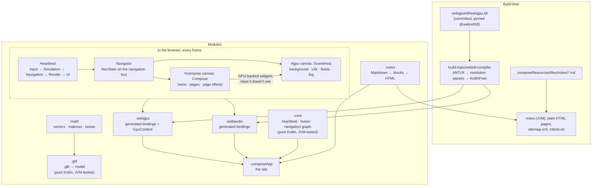

# maximums.github.io

A rainy street behind fogged glass, drawn with **WebGPU** from **Kotlin/Wasm**, with a **Compose Multiplatform** UI on
top. Behind the panes: the Game of Life and a murmuration of up to a million boids, both on compute shaders, and notes
on how it's built.

**Live:** [maximums.github.io](https://maximums.github.io) · **Notes:** [maximums.github.io/notes/](https://maximums.github.io/notes/)

## Architecture



- **Two canvases.** WebGPU draws the scene on `#gpu`; Compose draws the UI on a transparent `#compose` on top.
  Compose reports where its elements are, so the scene can draw effects behind them (the sphere behind the Welcome
  card), and passes the pointer input its widgets don't use down to the scene.
- **One clock.** Every animation, simulation and transition takes its time from the heartbeat.
- **Navigation is a graph.** Destinations are nodes, and edges carry transitions as values (`(melt with fogRoll) +
  holdFog + (fade with clearing)`). The model knows nothing about Compose or WebGPU; each layer renders the effects it
  registers.
- **The bindings are generated** from the specs' own WebIDL by the compiler in `build-logic`: WebGPU (`:webgpu`) and Web Audio (`:webaudio`, for the rain), both on the small shared runtime the generated code calls (`:webidl-runtime`).

[ARCHITECTURE.md](ARCHITECTURE.md) has the details, [DESIGN.md](DESIGN.md) the look ("Autumn Rain"), and
[PLAN.md](PLAN.md) the phases and what's next.

## Running it

You need JDK 21+ and Chrome (or another browser with WebGPU and WasmGC).

```
./gradlew :composeApp:wasmJsBrowserDevelopmentRun     # dev server on http://localhost:8080
./gradlew :composeApp:wasmJsBrowserDistribution       # production build in composeApp/build/dist/wasmJs/productionExecutable
```

Without WebGPU the site shows a still copy of the scene and the CPU Game of Life. Without WasmGC it shows a plain HTML
page with links to the notes.

## Tests

```
./gradlew -p build-logic :webidl-compiler:test   # WebIDL compiler: golden files and a compile test
./gradlew :core:jvmTest :notes:jvmTest :math:jvmTest :gltf:jvmTest
                                                 # heartbeat, buses, navigation, Markdown, matrices, glTF: on the JVM, in seconds
./gradlew wasmJsBrowserTest                      # everything in headless Chrome, including real GPU work
```

The browser tests run WebGPU on SwiftShader, Chrome's software GPU (flags in each module's `karma.config.d`). GPU code
is tested against CPU reference implementations: the Game of Life against `LifeEngine`, the boids against
`BoidsReference`, and the scan against a sequential prefix sum.

On Windows, `BINARYEN_CORES=1` in front of a Gradle command that builds the wasm keeps Binaryen from running out of
memory.

## Updating the WebGPU or Web Audio IDL (by hand)

Builds only ever read the committed files; nothing is downloaded during a normal build.

1. Pick a version of [`@webref/idl`](https://www.npmjs.com/package/@webref/idl) and pull its `webgpu.idl`:
   ```
   ./gradlew :webgpu:updateWebIdl -PwebrefVersion=3.84.0
   ```
   This rewrites `webgpu/idl/webgpu.idl` with a header naming the version. `:webaudio:updateWebIdl` does the same for
   `webaudio/idl/webaudio.idl`.
2. Review the diff, then build. The bindings regenerate from the new file (`:webgpu:transpileWebIdl`). If the compiler
   meets a type it doesn't know, the build fails and lists every unknown type and where it's used.
3. Fix whatever the API changes broke in the app, run the tests, and commit the IDL with the fixes.

The ANTLR grammar is pinned the same way, to a commit of `antlr/grammars-v4`:

```
./gradlew -p build-logic :webidl-compiler:updateWebIdlGrammar -PgrammarRef=<commit sha>
```

When a compiler change is meant to change the generated code, rewrite the goldens and review them as a diff:

```
./gradlew -p build-logic :webidl-compiler:test -PupdateGoldens
```

## Credits

- **Fonts:** Cormorant Garamond, Manrope and JetBrains Mono, under the SIL Open Font License (bundled with their licences in `composeResources/files/licenses`).
- **The rain:** ["Light rain on street"](https://freesound.org/s/380651/) by BonnyOrbit, on Freesound, CC0. Light rain recorded from an open window onto a city street at night. It plays only when turned on, from the "RAIN" hint. `tools/sounds/master-rain.sh` masters the site's files from it (ffmpeg): a 30 Hz high-pass, a plain gain to −30 LUFS, then Opus and an AAC fallback.

## Writing a note

Add `composeApp/src/commonMain/composeResources/files/notes/<slug>.md`, with front matter:

```
---
title: The title
date: 2026-10-18
summary: One or two sentences for the list, the description and link previews.
---
```

Then list its slug in `index.txt` next to it. The site renders it under Notes, and the build writes it as
`/notes/<slug>.html`. A note that isn't listed fails the build, so a draft can't go out by accident.
